<div align="center">

# Orbit Wars

**Model-based planning agent for a continuous 2D real-time strategy game**

[](https://www.kaggle.com/competitions/orbit-wars)
[](https://www.kaggle.com/competitions/orbit-wars/leaderboard)
[](https://www.kaggle.com/competitions/orbit-wars/leaderboard)
[](https://www.kaggle.com/competitions/orbit-wars/leaderboard)
[](https://www.python.org/)
[](https://pytorch.org/)

**Silver medal · 203 / 4729 teams · top 4.3%**

Team **puBERTat**: Semyon Morev · Kirill Gerasimov

[Результат](#результат) · [Идея](#идея-в-одном-абзаце) · [Архитектура](#архитектура) · [Эксперименты](#эксперименты) · [Команда](#команда) · [Запуск](#быстрый-старт)

</div>

---

> **TL;DR.** Мы построили не «ещё один жадный бот», а model-based planner для непрерывной RTS.
> Агент прогнозирует движение планет и флотов, считает **конкурентный поток кораблей** на горизонте
> 16–19 ходов, выбирает размер атаки из нескольких tiers и не даёт экономике просесть.
> В основе — точная модель механики игры, а не чёрный ящик. Результат: **Silver medal, 203/4729**.

---

## Результат

| | |
|---|---|
| **Соревнование** | [Orbit Wars](https://www.kaggle.com/competitions/orbit-wars) — Kaggle Featured Simulation Competition |
| **Команда** | **puBERTat** — Морев Семён (БПМ-25-4-2), Герасимов Кирилл (ББИ-25-2) |
| **Результат** | **Silver medal**, **203 / 4729** команд (**top 4.3%**) |
| **Финальный score** | **1152.3** |
| **Финальный сабмит** | 23.06.2026, версия `v45_turtle` |
| **Итоговый лидерборд** | 07.07.2026 |
| **Режимы** | 1v1 и 4P FFA, 500 ходов, 1 секунда на ход |
| **Стек** | Python, PyTorch, `kaggle-environments` |

В соревновании участвовали **4 729 команд**; призовой фонд — **$50 000**. Верхушка лидерборда —
сильные RL/инженерные команды; первое место заняла **Isaiah @ Tufa Labs**. Наш результат — Silver
на интерпретируемой эвристике с собственным симулятором и строгим офлайн-гейтом.

---

## Что такое Orbit Wars

Игра идёт на поле **100 × 100** с солнцем в центре. Каждый игрок стартует с одной планеты и
захватывает нейтральные и чужие планеты, отправляя флоты.

- Планеты **производят корабли** каждый ход; скорость зависит от `production` (1–5).
- Внутренние планеты **вращаются** вокруг солнца; внешние статичны.
- Флоты летят по прямой; **скорость растёт логарифмически** от размера флота (1–6 клеток/ход).
- Столкновения считаются по **непрерывной траектории**, а не по конечной точке.
- Солнце уничтожает флоты; кометы появляются группами и уходят с поля.
- В 4P победа **winner-take-all**; в 2P возможна ничья.
- Побеждает тот, у кого больше суммарно кораблей на планетах и в флотах к концу 500 ходов.

Полные правила и параметры движка: [`docs/GAME_RULES.md`](docs/GAME_RULES.md).

---

## Почему задача сложная

| Сложность | Что это значит для агента |
|---|---|
| **Непрерывная геометрия** | Нельзя думать «планета A → планета B»: цель движется, флот летит с опережением, а по пути его может перехватить другая планета или солнце. |
| **Нелинейная скорость** | Большой флот быстрее маленького, но отправка всех кораблей оголяет планету. Нужен компромисс между размером, ETA и риском. |
| **Комбинаторный action space** | На каждом ходу — десятки источников × десятки целей × разные размеры флота. Жадный выбор одной цели на источник почти всегда слабее. |
| **Снежный ком** | К 50-му ходу игрок с ~21+ production обычно начинает доминировать. Ошибка в opening стоит всей игры. |
| **Разные игры** | 2P — дуэль с возможной ничьей; 4P — FFA, где второе место не лучше последнего. Одна политика на оба режима проигрывает. |
| **Дедлайн** | 1 секунда на ход, без права на «подумать ещё». Нужна векторизация и бюджет времени. |

---

## Идея в одном абзаце

Мы оптимизируем не «захват конкретной планеты», а **изменение конкурентного потока кораблей**.
Для каждого кандидата агент пересчитывает производство, потери в бою и владение на горизонте
$H$ и выбирает ход, который максимизирует наш net ship flow минус sum соперников. Это
автоматически учитывает snowball, ценность production и то, что в 4P усиление любого соперника
нам вредит.

---

## Архитектура

```mermaid
flowchart LR
    O["Observation<br/>planets · fleets · comets"] --> A["Adapter<br/>dict → tensors"]
    A --> M["Movement model<br/>rotation · comets · fleet tracking"]
    M --> G["Garrison projection<br/>owner / ships / arrivals over H"]
    G --> C["Candidate generator<br/>source × target shortlists"]
    C --> S["Competitive scorer<br/>Δ net ships for all players"]
    S --> P["Planner<br/>multi-size tiers · greedy · commitments"]
    P --> R["Regroup & defense<br/>pressure gradient · safe drain"]
    R --> X["Launch list<br/>[from, angle, ships]"]
```



Пайплайн одного хода:

1. **Observation → tensors.** Планеты, флоты, кометы и `initial_planets` раскладываются в
   именованные тензоры; никаких магических индексов вниз по коду.
2. **World model.** `PlanetMovement` предсказывает позиции вращающихся планет и комет,
   отслеживает известные флоты и строит `PlanetGarrisonStatus` — прогноз owner/ships на
   каждый ход горизонта.
3. **Candidate generation.** Короткие списки источников (по garrison) и целей (по близости,
   production и защите), проверка достижимости, расчёт угла перехвата.
4. **Scoring.** Для каждого кандидата считается не «хватит ли кораблей», а изменение
   конкурентного потока на горизонте.
5. **Selection.** Multi-size tiers, жадный выбор лучшей волны, одна волна на цель, бюджет
   источников, role mutex.
6. **Regroup.** Остатки стягиваются с тыловых планет на фронт по градиенту давления.

---

## Ключевые идеи

### 1. Цель — выиграть поток, а не отдельную планету

В 4P победа winner-take-all: второе место не даёт ничего. Поэтому «захватить побольше планет»
— не цель. Цель — чтобы к концу игры наш поток кораблей был больше, чем у каждого соперника.

Для кандидата $a$ считаем:

$$
\Delta \text{net}_i(a) = \Delta\left(\text{production}_i - \text{combat losses}_i\right) \quad \text{за } H \text{ ходов}
$$

$$
\text{score}(a) = \Delta \text{net}_{\text{us}}(a) - \sum_{j \ne \text{us}} \Delta \text{net}_{j}(a)
$$

Это не «жадность по garrison»: ход может не захватить планету сразу, но резко улучшить
позицию через несколько ходов. И наоборот — «дешёвый» захват, который будит сильного соседа,
получает отрицательный score.

### 2. Точная модель движения вместо реактивного бота

Планеты вращаются, флоты летят с разной скоростью, а столкновение считается по отрезку пути.
Поэтому угол — это не `atan2(target - source)`, а решение уравнения перехвата:

$$
t^* = \frac{\lVert p_{\text{target}}(t^*) - p_{\text{source}} \rVert}{v(n)}
$$

Решаем fixed-point итерацией, затем проверяем **первое касание** луча с учётом солнца и
промежуточных планет. Это убирает целый класс «красивых, но невозможных» атак.

### 3. Capture floor с поправкой на подкрепление

Стандартный вопрос «сколько кораблей нужно, чтобы захватить планету?» имеет неверный ответ,
если соперник успеет прислать подкрепление. Мы считаем floor на момент прибытия:

$$
\text{floor}(k) = \left\lceil \text{defenders}(k) + \text{overhead} + \beta \cdot \rho(\eta) \cdot C_k \right\rceil
$$

- $C_k$ — масса вражеских кораблей, которые физически могут дойти до цели за время полёта;
- $\rho(\eta)$ — ramp от 0 до 1: короткий полёт соперник не успевает отреагировать, длинный — успевает;
- $\beta$ — tuned-коэффициент.

Так агент **отказывается от заведомо провальных атак**, вместо того чтобы sink'ать гарнизон
в планету, которую через 3 хода отобьют.

### 4. Multi-size commit tiers

На каждую пару `(source, target)` рассматриваются несколько размеров флота:

```text
0.5 × safe_drain    0.75 × safe_drain    1.0 × safe_drain
```

Маленькая волна освобождает корабли для второго фронта; большая — быстрее и сильнее. Жадный
селектор выбирает лучший tier, а не «всегда all-in». Это особенно важно в 4P, где нужно
одновременно держать несколько направлений.

### 5. Safe drain и regroup

`safe_drain` — максимальное число кораблей, которое можно снять с планеты, не потеряв её на
горизонте. Формально:

$$
\text{safe\_drain} = \min_{t \in \text{held}} \text{ships}_t
$$

Если планета всё равно обречена — ограничение снимается, и гарнизон можно эвакуировать.
Остатки после атак не сгорают: `regroup` двигает их с тыла на фронт по градиенту
«достижимая вражеская масса», но только если цель всё ещё наша к моменту прибытия.

### 6. 2P и 4P — разные игры, разные конфиги

| Параметр | 2P (turtle) | 4P (field-tuned) |
|---|---:|---:|
| Горизонт | 19 | 16 |
| ROI threshold | 2.1 | 2.535 |
| Min ships to launch | 9.0 | 7.322 |
| Sources / targets | 16 / 15 + 5 | 7 / 11 + 1 |
| Size tiers | 0.5 / 0.75 / 1.0 | 1.0 |
| Regroup window | 6.5 ходов | 5.2 ходов |

В 2P мы играем **turtle**: высокий ROI, терпеливые захваты, сильная экономика. В 4P —
агрессивнее по числу источников и волн, но с более коротким горизонтом, чтобы не переоценивать
далёкие цели. Это не «магические цифры»: они получены SPSA-тюнингом и проверены на разных
пулах соперников.

### 7. Что дальше: adaptive 2P

После финального сабмита мы собрали экспериментальную ветку `v46_adaptive`: она считает
частоту запусков соперника к 30-му ходу и переключается между turtle и aggressive 2P.
В зачёт пошла стабильная `v45`; `v46` лежит в [`experimental/v46_adaptive`](experimental/v46_adaptive)
как исследовательский артефакт, а не как заявленный результат.

---

## Инженерия

Silver нельзя получить только формулой — нужна инфраструктура, которой можно доверять.

| Компонент | Что делает |
|---|---|
| **PyTorch-векторизация** | Скоринг сотен кандидатов за один проход; `sparse_launch_flow_delta` пересчитывает только затронутые планеты, а не весь мир. |
| **Точный симулятор** `sim/orbit_batch.py` | Батчевый порт механики движка на `float64`: вращение, production, движение, swept-collision, combat. |
| **Parity-тесты** `sim/parity.py` | Сверяют симулятор с **реальным** `kaggle_environments` на ground-truth переходах, а не «на глаз». |
| **Field gate** `tools/field_gate.py` | 2P — bias-cancelled round-robin; 4P — rotating mixed pool. Результаты пишутся в CSV и резюмируются. |
| **Bias-cancelled duels** `tools/realduel.py` | Каждый seed играется в обоих слотах, чтобы не поймать преимущество первого игрока. |
| **Replay mining** | Скачивание и разбор реплеев топ-лидерборда; калибровка локального гейта по реальным эпизодам. |
| **SPSA** | Black-box тюнинг десятков параметров на свежих seed-блоках, с чекпоинтами и историей. |
| **Packaging** | Сабмит — tar.gz с `main.py` в корне и `orbit_lite/`; smoke-тест распакованного архива в изоляции. |

Масштаб работы: **121 версия/вариант агента**, **38 сабмитов**, **1 357 реплеев** для BC-линии,
финальный агент — около **5 000 строк** Python.

---

## Эксперименты

### Что сработало

| Гипотеза | Как проверяли | Результат |
|---|---|---|
| Turtle 2P вместо aggressive | Strong-clone field, paired seeds | **+12.5 pp** против aggressive-конфига `v42` |
| 4P field tuning | Mixed 4P pool, rotating seats | **+4.5…8 pp** на локальном гейте |
| Multi-size waves | Прямые дуэли 2P | **64%** против `v33` |
| ETA-aware reinforcement | Сравнение capture quality | Меньше «doomed» атак, стабильнее экономика |

### Что не сработало — и почему это важно

| Линия | Результат | Решение |
|---|---|---|
| 2-ply search с exact opponent oracle | **−4.6 pp** на разнообразном поле, **−8.1 pp** на зеркале | Закрыли: короткий rollout — шумный value |
| BC по 1 357 реплеям топ-10 | **34%** против `v3` при баре 70% | Закрыли: distribution shift, нет DAgger |
| RL/PPO self-play | Не превзошёл эвристику | Инфраструктура сохранена, в сабмит не пошла |
| Aggressive 2P SPSA | +7.9 pp на 6/6 блоках, затем **−6.2 pp** на другом пуле | Откатились к turtle |

Главный вывод: **один красивый результат — это ещё не улучшение**. Мы принимали изменения
только после двух независимых seed-блоков и как минимум двух разных пулов соперников. Это
спасло от нескольких «побед», которые были шумом.

---

## Команда

| Участник | Роль | Вклад |
|---|---|---|
| **Морев Семён** (БПМ-25-4-2) | Research / strategy | Разбор механики движка и реплеев, постановка цели через $P(\text{win})$, гипотеза production snowball, конкурентная оценка потока, ETA-aware reinforcement risk, multi-size commit, разделение 2P/4P, критерии приёмки и выбор финальной конфигурации. |
| **Герасимов Кирилл** (ББИ-25-2) | ML / infrastructure | PyTorch-векторизация, точный батчевый симулятор и parity-тесты, field gate, SPSA, replay pipeline, bias-cancelled duels, упаковка и воспроизводимость сабмитов. |

Оба участвовали в код-ревью, запуске экспериментов и разборе результатов. Разделение ролей
условное: «идея» и «инфраструктура» постоянно проверяли друг друга.

---

## Структура репозитория

```text
.
├── main.py                     # финальный сабмит v45_turtle
├── orbit_lite/                 # world model, planner core, adapter, aiming
├── experimental/
│   └── v46_adaptive/           # post-final adaptive 2P experiment
├── sim/                        # батчевый симулятор + parity-тесты + oracle dumps
├── tools/                      # duels, field gate, replay mining, SPSA
├── docs/
│   └── GAME_RULES.md           # полные правила и параметры движка
├── NOTICE.md                   # attribution публичных baseline-решений
└── requirements.txt
```

---

## Быстрый старт

```bash
python -m venv .venv
source .venv/bin/activate
pip install -r requirements.txt
```

Проверка агента в реальном движке:

```python
from kaggle_environments import make

env = make("orbit_wars", configuration={"seed": 42})
env.run(["main.py", "random"])

print([(i, s.reward, s.status) for i, s in enumerate(env.steps[-1])])
```

Bias-cancelled дуэль на реальном движке:

```bash
python tools/realduel.py --a main.py --b random --players 2 --seeds 8 --jobs 4
```

Parity-тест симулятора:

```bash
cd sim
python parity.py
```

---

## Научная честность и attribution

Orbit Wars — игра и движок Kaggle; правила и параметры принадлежат организаторам соревнования.

Отправной точкой для агента стал **открытый baseline** [The Producer](https://www.kaggle.com/code/slawekbiel/the-producer-agent)
(Slawek Biel). Мы также изучали публичные решения [Vickimar](https://www.kaggle.com/code/vickimar/orbit-wars-heuristic-lb-1110)
и [Roman Tamrazov](https://www.kaggle.com/code/romantamrazov/orbit-star-wars-lb-max-1224) и
указываем авторов в [`NOTICE.md`](NOTICE.md).

Мы **не выдаём чужой код за свой**. Наш вклад — это переработка архитектуры, собственная
модель движения, конкурентный scorer, ETA-aware capture floor, multi-size tiers, раздельные
2P/4P конфиги, симулятор, field gate и вся экспериментальная дисциплина, которая привела к
Silver. Публичные baseline использовались как научная литература: их нужно воспроизвести,
понять и превзойти, а не копировать вслепую.

---

## Ссылки

- [Kaggle: Orbit Wars](https://www.kaggle.com/competitions/orbit-wars)
- [Финальный лидерборд](https://www.kaggle.com/competitions/orbit-wars/leaderboard) — команда `puBERTat`, 203/4729
- [Правила и параметры движка](docs/GAME_RULES.md)
- [The Producer baseline](https://www.kaggle.com/code/slawekbiel/the-producer-agent)
- [Vickimar baseline](https://www.kaggle.com/code/vickimar/orbit-wars-heuristic-lb-1110)
- [Roman baseline](https://www.kaggle.com/code/romantamrazov/orbit-star-wars-lb-max-1224)

---

<div align="center">
<sub>Собрано для защиты результата и перезачёта. Все эксперименты воспроизводимы из этого репозитория.</sub>
</div>
